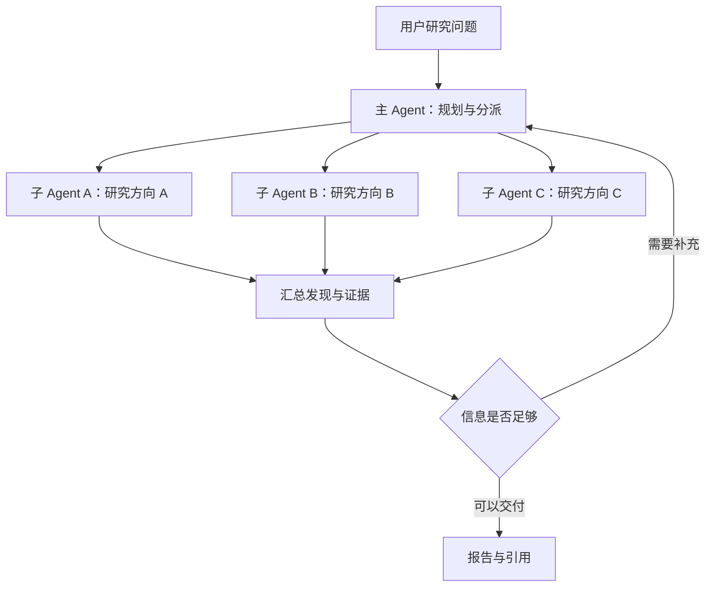
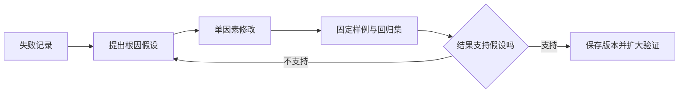

# Claude 多智能体研究系统：阅读笔记与工程补充

> **原文**：[How we built our multi-agent research system][article]  
> **作者团队**：Anthropic Engineering  
> **原文发布日期**：2025-06-13  
> **笔记整理与文档核查日期**：2026-11-04  
> **阅读目标**：理解研究型多 Agent 系统的协作方式、评估方法与生产取舍。

本文根据个人阅读笔记重组、校订，并补充实现建议。标记约定：**原文经验**指该团队当时报告的实践；**工程补充**指由此延伸的建议；**文档更新**指核查时的产品文档。案例数字不应直接推广到所有模型和业务。

## 目录

- [1. 系统全貌与适用边界](#overview)
- [2. 交错推理与扩展思考](#thinking)
- [3. 提示词、任务委派与工具设计](#orchestration)
- [4. 调试与快速迭代](#debugging)
- [5. 跨模型差异的诊断方法](#diagnosis)
- [6. 多 Agent 系统如何评估](#evaluation)
- [7. 生产可靠性与上下文管理](#reliability)
- [8. 彩虹发布与版本兼容](#deployment)
- [9. 同步协调、并行与异步协作](#concurrency)
- [10. Cookbook 与实践清单](#practice)
- [附录 A：重要表述修正](#corrections)
- [附录 B：原始笔记与新结构对应关系](#mapping)

<a id="overview"></a>
## 1. 系统全貌与适用边界

### 1.1 从整体流程理解协作

**原文经验**：系统采用 orchestrator–worker 架构，由主 Agent 拆解任务，子 Agent 并行研究，再汇总结果。独立上下文让各子任务容纳自己的检索过程。[原文][article]

下图是帮助理解的简化流程，不表示完整服务端实现：



**工程补充**：理解协作时，应同时追踪三种流动：任务由谁分派，数据由谁持有，控制权何时转交。角色名称本身不能保证有效分工。

### 1.2 多 Agent 的四类局限

以下是对原笔记的工程化归纳，不是原文正式提出的四维分类。

| 局限 | 发生机制 | 常见表现 | 可采用的措施 |
|---|---|---|---|
| 错误与信息损失传播 | 下游依赖上游结论，且没有充分核验 | 错误前提被继续使用；摘要遗漏关键条件 | 保留证据引用；设置阶段检查；把结论与未知事项分开 |
| 全局上下文协调困难 | 子任务共享大量约束或持续修改同一对象 | 决策互相冲突；重复同步大量资料 | 明确状态所有者；减少共享写入；评估固定工作流或单 Agent |
| 协调成本与延迟 | 额外的模型调用、工具等待、信息序列化和重复处理 | 管理开销抵消并行收益 | 减少不必要委派；传递摘要与产物引用；控制并发 |
| 执行路径不稳定 | 模型输出、外部数据和并发时序共同影响后续动作 | 同题不同路径；反复返工；无法及时停止 | 设置预算、超时、终止条件；保存执行轨迹；重复评估 |

需要区分两个概念：**级联错误**是错误向后传播；**传话损失**是多次摘要或转述损害信息保真度。两者可能同时出现，但不是同义词。

“指数级放大”“Token 几何级增长”都需要具体模型和测量支持。更稳妥的表述是：依赖、重复传输和协调轮次增加时，成本和故障传播风险可能上升。

### 1.3 如何选型

**原文经验**：大量可并行探索的研究工作更适合这一架构；共享上下文多、依赖密集的任务更难获益。这是对当时系统与模型的观察。[原文][article]

**工程补充**：根据任务结构选择方案，再做同条件比较。

| 任务特征 | 优先评估的方案 |
|---|---|
| 简单查询、工具少、上下文集中 | 单 Agent 或直接工具调用 |
| 步骤清晰、依赖明确、需要稳定控制 | 确定性工作流，必要节点使用 Agent |
| 多个独立方向、可分别搜集证据 | 并行子 Agent + 汇总 |
| 大量共享修改、强一致性约束 | 明确写入所有权的工作流，配合事务、校验或人工介入 |

不必把选型简化为“多 Agent 与长上下文单 Agent 二选一”。更长上下文也不自动解决状态一致性、遗漏和工具错误。

<a id="thinking"></a>
## 2. 交错推理与扩展思考

### 2.1 先区分三个层次

| 概念 | 描述的层次 | 核心问题 |
|---|---|---|
| ReAct | 推理与行动结合的 Agent 模式 | 如何利用环境反馈决定下一步行动？ |
| Interleaved thinking | 在工具调用之间进行思考的能力或运行方式 | 工具返回后如何重新评估信息？ |
| Extended / adaptive thinking | 模型及 API 的推理计算配置 | 是否投入额外推理计算，以及如何控制投入？ |

三者有关联，但不能直接画等号。交错思考也不意味着每次工具调用之后都必须出现一段用户可见的思考文本。具体支持方式见 [Thinking in tool workflows][thinking-tools]。

### 2.2 交错推理如何帮助研究

```text
当前目标与已有证据
    → 选择工具和参数
    → 执行工具
    → 检查结果质量、相关性和缺口
    → 调整计划，或结束任务
```

**原文经验**：主 Agent 规划任务、工具与分工；子 Agent 在工具返回后评估质量、识别缺口并调整搜索。[原文][article]

**工程补充**：可以让 Agent 在关键节点回答几个简短的工作问题：已有证据支持什么、还缺什么、下一步为何值得执行。这是外显工作记录，不要求暴露内部思维链。

这类机制能提供纠错机会，但不能保证模型识别全部错误。检索结果的压缩也需要单独设计输出协议，不能仅靠“多思考”自然完成。

### 2.3 不把 CoT 等同于僵硬执行

原笔记中“标准 CoT 想好全部步骤后无法调整”的对比不准确。CoT 描述推理表达方式，并不直接规定是否调用工具、是否重规划。

更合适的比较对象是**预先确定且不更新的计划**与**根据反馈更新的计划**。前者适合稳定流程；后者适合步骤不完全可预知的研究任务。

### 2.4 推理预算、收益与成本

**工程补充**：额外推理计算可能改善复杂任务表现，也可能增加成本而没有明显收益。不要预设所有任务遵循统一的“思考 Token—性能对数定律”，也不要预设创作任务一定受益或一定变差。

合理的调参方式是固定测试集，对不同配置比较成功率、费用和耗时。原文提到 Token 使用量与表现差异的统计关系，不足以证明“交错推理 Token 就是表现提高的原因”；总 Token 也不能等同于 reasoning tokens。

**文档更新（2026-11-04）**：手动 `budget_tokens` 已被标为 legacy，其可用性依赖模型；当前文档提供自适应思考与 effort 等控制方式。`budget_tokens` 的单位是 Token，不是推理步骤；effort 也不是任务总费用的硬上限。[手动思考文档][extended] · [思考投入与成本控制][adaptive]

### 2.5 可见内容不等于原始思维链

当前 Claude 文档说明，可见 thinking 文本是摘要，也可能被省略；不能把它当作完整内部计算记录。发送历史 thinking blocks 时应遵循接口要求，原样传回，不应任意编辑后继续提交。摘要更短不等于按摘要长度计费。[Thinking 文档][thinking]

<a id="orchestration"></a>
## 3. 提示词、任务委派与工具设计

### 3.1 原文的八项实践

原笔记把原文原则重新分组后写成了“七大原则”。为便于对照原文，这里恢复为八项；“启发式指导与护栏”是随后对整体策略的归纳。[原文][article]

| 原则 | 要解决的问题 | 阅读后应落实的动作 |
|---|---|---|
| 1. 从 Agent 的视角观察 | 提示词效果与预期不同 | 查看真实工具选择、参数、返回和停止位置 |
| 2. 教协调者如何委派 | 子任务重叠、范围模糊 | 指定目标、输出格式、来源/工具和边界 |
| 3. 按任务复杂度分配投入 | 简单问题消耗过多资源 | 给出分配启发式，并在程序层限制预算 |
| 4. 设计清晰的工具接口 | 选错工具或误用参数 | 说明用途、适用范围、输入与输出 |
| 5. 用 Agent 辅助改进 | 工具描述中的细节难发现 | 让模型提出候选修改，再运行回归评估 |
| 6. 先广后窄地检索 | 过早使用冗长、过窄查询 | 先理解问题范围，再逐步聚焦 |
| 7. 引导规划与反馈处理 | 不知道下一步该查什么 | 根据目标、证据与缺口调整行动 |
| 8. 在两个层次使用并行 | 独立检索被串行执行 | 子 Agent 间并行；子 Agent 内独立工具调用并行 |

### 3.2 任务委派：从角色名称变成明确契约

**工程补充示例**：分派“调查某产品的部署方案”时，避免只给“你是云架构专家”这样的角色说明。

```yaml
task_id: deployment-research-01
objective: 比较产品 X 的托管与自行部署方案
scope:
  include: [运行环境, 状态持久化, 故障恢复, 费用构成]
  exclude: [市场宣传, 无来源的性能排名]
sources:
  prefer: [官方文档, 官方源码, 官方工程文章]
constraints:
  max_tool_calls: 8
  timeout_seconds: 180
output:
  required: [findings, evidence_refs, uncertainties, status]
stop_when: 范围已覆盖，或预算耗尽且已记录未完成部分
```

数值仅用于演示。真正的限流、权限、超时和预算应由程序执行，不能只在提示词里声明。

### 3.3 资源分配规则是经验参数

原文报告过以下提示规则：[原文][article]

| 当时的查询类型 | 当时使用的分配建议 |
|---|---|
| 简单事实查找 | 1 个 Agent，3–10 次工具调用 |
| 直接比较 | 2–4 个子 Agent，每个 10–15 次调用 |
| 复杂研究 | 可能使用超过 10 个、分工清晰的子 Agent |

这些不是行业标准，也不是推荐直接复制的生产默认值。任务是否需要更多 Agent，应由信息缺口和实测收益决定。

### 3.4 工具设计是协作质量的一部分

**工程补充**：每个工具至少讲清用途、参数约束、结果结构与错误语义。对写操作还应说明授权要求、是否幂等、怎样确认成功。

“先广后窄”适合探索性问题；已知精确标识符、错误码或文档地址时，可以直接定点查找。工具很多时，也不必把所有描述重复塞进每个 Agent 的上下文，应按任务提供相关工具。

### 3.5 模型辅助优化需要人工与评估闭环

**原文经验**：团队让模型辅助分析失败、改进提示词和工具描述，并报告工具描述优化后任务完成时间减少约 40%。这是该实验的结果，不是普遍保证。[原文][article]

**工程补充**：把模型建议视为待验证假设；保留原版本，对失败样例和未参与调参的样例一起测试。不要让测试 Agent 未经检查就直接更新生产提示词。

### 3.6 阅读性能数字时保留实验范围

| 原笔记记录的数字 | 应如何理解 |
|---|---|
| 工具描述优化后，完成时间减少约 40% | 该团队工具优化实验的观察结果 |
| 双层并行使复杂查询的研究时间最多减少 90% | 特定复杂查询的加速，不是所有请求的平均收益 |
| Token 使用量解释约 80% 的表现方差 | 原文对 BrowseComp 的统计分析，不是准确率提高 80%，也不是因果证明 |

上述数字来自原文。评估自己的系统时，需要重新测量任务分布、基线、预算、质量和耗时。[原文][article]

<a id="debugging"></a>
## 4. 调试与快速迭代

### 4.1 原文的 Console 描述能证明什么

**原文经验**：团队在 Console 中使用系统的提示词和工具构建模拟，观察逐步执行，以发现无效继续、检索词过长和工具选择错误。[原文][article]

这不能推出 Console 必然具有传统调试器的任意断点、完整状态冻结、原始思维链展示或思维链任意改写功能。具体界面能力需要单独验证。

### 4.2 通用的可控重放流程

以下是**工程补充**，可以在自己的测试程序中实现，不依赖某个 Console 的特定按钮。

1. **记录失败样例**：保存输入、版本、工具参数、返回结果、状态变化与停止原因。
2. **缩小问题范围**：确认偏差发生在分派、检索、参数生成、工具执行还是结果汇总。
3. **构造测试分支**：使用固定的工具返回样本，明确标记为 mock，不覆盖原始记录。
4. **一次改一个因素**：分别测试提示词、工具描述、数据、模型配置或执行逻辑。
5. **重复运行并回归**：检查目标问题是否改善，以及其他任务是否退步。



模拟工具结果有助于隔离变量，但修改后的结果只能证明受控条件下的行为。随后还应验证真实工具链。

### 4.3 如何减少调试成本

- 小样本阶段先排除格式、路由和工具接口错误，再增加复杂任务的推理投入。
- 对重复出现的稳定输入前缀评估 prompt caching。
- 比较每次尝试的费用与“完成一个合格任务”的总费用，避免低价配置因反复失败反而更贵。

**文档更新**：缓存命中可降低重复输入部分的处理成本，但仍有缓存写入、失效和不命中成本；它不等于整个 Agent 任务便宜 90%，也不缓存外部工具的真实执行结果。[Prompt caching][caching]

<a id="diagnosis"></a>
## 5. 跨模型差异的诊断方法

本节是**工程补充**，不是原文提出的“四步诊断法”。同一提示词跨模型表现不同，只能说明系统组合的表现不同，不能直接归因为模型内部架构或能力上限。

### 5.1 先做系统层排查

| 现象 | 可能原因 | 首先检查 |
|---|---|---|
| JSON 格式错误 | 指令不清、截断、接口配置、模型表现 | 输出上限、停止原因、schema、结构化输出支持 |
| 工具参数错误 | 描述含糊、字段歧义、上下文不足 | 参数校验、工具说明、少量示例 |
| 工具选对但结论错误 | 工具数据不完整、时效性、推理或汇总问题 | 原始证据是否支持结论；单位与时间范围是否一致 |
| 忽略步骤或约束 | 冲突指令、状态遗漏、预算不足 | 实际发送上下文与执行事件 |
| 拒绝或回答过短 | 明确拒绝、任务歧义、输出截断、服务错误 | API 状态、停止原因和明确拒绝信息 |

格式错误不唯一对应提示词问题；逻辑错误也不自动证明能力已到上限。对拒绝应先核查请求本身和适用规则，再澄清合法任务与上下文，不能从模糊回答推断“触发敏感词”。

### 5.2 控制变量比较

1. 固定任务集、工具结果、评价标准和运行环境。
2. 记录模型版本、提示词、推理配置、费用和耗时；相同参数名不保证跨模型语义一致。
3. 测试少量语义一致的提示词变体与明确示例，检查对表达方式的敏感性。
4. 重复运行，并在未参与修改的样例上验证效果。
5. 分别报告共同提示词下的可移植性，以及各模型合理调优后的表现。

三组变体可以作为早期探索，不能作为“证明模型无能”的统计标准。启用额外思考后表现改善，也不能单独证明原提示词存在漏洞，因为计算预算同时发生了变化。

### 5.3 如何决定下一步

- 证据缺失：优先改检索、工具或上下文输入。
- 接口不稳定：优先用 schema、程序校验和错误处理降低脆弱性。
- 当前模型在代表性任务中持续不达标：评估换模型、缩小职责或拆解任务。
- 复杂节点需要更强模型：可以分级路由，但更换模型与采用单 Agent/多 Agent 是两个不同的架构决定。

<a id="evaluation"></a>
## 6. 多 Agent 系统如何评估

### 6.1 结果正确与过程合理都要检查

**原文经验**：有效执行路径可以不止一条，评估应关注是否完成目标及过程是否合理，而不是要求每次搜索顺序完全相同。[原文][article]

**工程补充**：这是对开放式任务评估的提醒，不意味着传统软件或所有单 Agent 都只能按固定路径测试。对权限、审批和业务规则等硬约束，仍应明确校验过程。

### 6.2 从小样本开始，但不止于小样本

**原文经验**：团队从约 20 个代表性查询起步，以快速发现早期的大幅变化。[原文][article]

**工程补充**：早期样例用于发现问题；随着系统成熟，逐步覆盖长尾、失败恢复和真实业务分布。保留独立测试集，对随机性明显的任务重复运行。20 个样例不足以证明高可靠性。

### 6.3 研究任务的五个评估维度

| 维度 | 检查问题 | 工程补充的验证方式 |
|---|---|---|
| 事实准确性 | 结论是否有证据支持？ | 对照证据快照，检查日期、实体、数值与限定条件 |
| 引用准确性 | 引用来源是否支持相邻主张？ | 校验链接和引用对应关系 |
| 完整性 | 用户要求的方面是否覆盖？ | 按需求清单逐项检查 |
| 来源质量 | 来源是否适合支持这一类主张？ | 优先一手依据，结合时效性、相关性与利益关系判断 |
| 工具效率 | 调用是否合理，是否存在重复或无效行动？ | 结合轨迹、调用次数、费用与耗时分析 |

五个维度来自原文的 rubric；最后一列是实现建议。[原文][article]

不能只把最终报告给裁判，却要求它准确评价未提供的工具轨迹。也不能因为来源是“个人博客”就一概降低评价，作者对亲历工程实践的记录可能是一手材料。

### 6.4 LLM-as-a-judge 与人工复核

**原文经验**：团队发现单次 LLM 调用、统一 rubric、0–1 分数及通过/不通过判断，在其设置下较一致；人工测试还发现了对 SEO 内容的来源偏好。[原文][article]

**工程补充**：

- 用带人工标注的样例校准裁判；要求给出可核验的判分依据。
- 将可由代码检查的字段、数值和业务状态交给代码验证。
- 将外部文本作为待评材料，避免其中的指令改变评分规则。
- 对高影响、争议或低置信结果人工复核；不要把单个裁判当作事实真值。
- 模型、提示词或工具升级后重跑评估，不能只看一次成功演示。

### 6.5 写操作需要终态验证

**原文补记**：对于会修改环境的任务，原文附录建议检查最终状态，并在复杂流程中设置关键检查点。[原文][article]

**工程补充示例**：Agent 声称“工单已创建”，应核验工单系统中是否存在对应记录、字段是否正确、是否重复创建。最终状态正确，也不能抵消未经授权的操作。

<a id="reliability"></a>
## 7. 生产可靠性与上下文管理

### 7.1 持久化与恢复

**原文经验**：长任务发生错误后从头重跑代价高；团队结合检查点、重试与模型对工具失败的适应能力。[原文][article]

**工程补充**：恢复点通常是已持久化的步骤或事件边界，不能承诺从任意内部推理位置“精确续传”。

| 状态 | 示例 | 建议持久化内容 |
|---|---|---|
| 任务状态 | 主任务与子任务的进行情况 | ID、父子关系、状态、版本、预算 |
| 执行记录 | 工具调用与返回 | 参数、结果引用、错误、耗时、重试次数 |
| 研究产物 | 证据、阶段结论、报告 | 内容或存储引用、来源和版本 |
| 外部副作用 | 创建工单、写入业务系统 | 操作标识、幂等键、实际执行结果 |

恢复前应判断：调用是否实际成功、哪些步骤可以重试、重复执行是否有副作用。检查点不自动提供外部写入的恰好一次语义。

### 7.2 程序容错与模型适应各司其职

| 层次 | 适合负责的事情 |
|---|---|
| 程序 | 超时、有限重试、退避、权限、幂等、持久化、预算、取消 |
| Agent | 选择替代信息源、修改查询、缩小任务、说明证据不足 |

模型换一个搜索策略，不能替代底层状态一致性；程序反复重试，也不能解决任务本身不存在答案的问题。

### 7.3 全链路追踪与隐私

**原文经验**：追踪有助于定位“找不到明显信息”的原因；团队还观察决策模式与交互结构。[原文][article]

**工程补充**：优先记录任务关系、工具名称、参数校验结果、耗时、错误、状态变化与版本。必要内容应按权限、脱敏和保留策略采集。

不能把“完整追踪”理解为保存全部原始聊天、凭据和内部思维链。脱敏测试集用于内容级重放；生产元数据用于模式监控，两者可以组合。

### 7.4 长上下文与产物交接

**原文补记**：附录讨论阶段总结、外部记忆、新上下文交接，以及子 Agent 保存产物后回传轻量引用。[原文][article]

**工程补充**：交接记录应保留目标、已验证发现、证据引用、失败尝试、未完成事项和剩余预算。摘要应允许回查原始证据，防止错误在反复摘要后被当成已确认事实。

对于代码、表格或报告，可以返回：

```json
{
  "task_id": "research-01",
  "status": "partial",
  "summary": "已完成两个部署方案的比较，缺少某项恢复指标。",
  "artifact_ref": "artifacts/research-01/report-v1.md",
  "evidence_refs": ["sources/doc-01", "sources/doc-02"],
  "unresolved": ["官方资料未明确给出恢复时间指标"]
}
```

这是自定义示例，不是 Claude API 的原生返回格式。引用还需要可访问、可授权、可保留，并与明确版本绑定。

<a id="deployment"></a>
## 8. 彩虹发布与版本兼容

### 8.1 彩虹发布解决什么问题

**原文经验**：为了避免升级打断正在运行的 Agent，团队采用 rainbow deployments，让不同版本共存并迁移流量。[原文][article]

彩虹发布不是 Agent 专属的新概念；被引用的实践来自长连接服务。其核心是允许旧版本有较长的排空时间，同时继续发布新版本。[Rainbow Deploys with Kubernetes][rainbow]

### 8.2 三种策略比较

| 策略 | 重点 | 对长任务需要额外考虑什么 |
|---|---|---|
| 蓝绿发布 | 新旧环境之间切换流量 | 切换后仍需处理旧任务与连接 |
| 金丝雀发布 | 用有限流量观察新版本表现 | 流量比例、任务归属与旧任务排空可以分别设计 |
| 彩虹发布 | 多个版本并存，允许较长排空周期 | 旧版本数量、资源成本、兼容性与回收期限 |

这是工程上的比较视角。金丝雀并不必然“严格只有两个版本”，几种策略也可以组合。

### 8.3 一个可采用的发布流程

以下是**工程补充**：

1. 给代码、提示词、工具 schema 和状态结构记录兼容版本。
2. 新版本先通过回归与小范围验证。
3. 新任务按发布策略进入新版本，旧任务尽可能留在兼容环境中完成。
4. 新版本出现问题时停止新流量；对已运行任务另行决定继续、取消或迁移。
5. 排空后回收旧版本，并为异常长任务设置期限及恢复方案。

回滚流量不等于回滚外部副作用。彩虹发布也不能自动保证零中断；进程故障、存储变化和接口不兼容仍需处理。

<a id="concurrency"></a>
## 9. 同步协调、并行与异步协作

### 9.1 同步等待不等于串行执行

**原文经验**：当时系统可以并行运行一批子 Agent，但主 Agent 等待这一批完成后再推进。原文讨论了这种等待方式的限制与异步化的代价。[原文][article]

```text
批次协调：A、B、C 同时执行 → 等待整批完成 → 主 Agent 继续
事件驱动：A、B、C 同时执行 → A 先完成 → 主 Agent 处理 A，B/C 可继续
```

因此，“同步 = 没有并行”是不成立的；一个慢任务拖住整批通常是等待屏障或长尾问题，不一定是严格意义上的死锁。

### 9.2 异步协作的取舍

| 维度 | 批次等待 | 事件驱动的异步协调 |
|---|---|---|
| 信息汇总 | 批次完成后统一处理 | 按结果到达顺序增量处理 |
| 实现难度 | 较容易形成稳定边界 | 需要处理乱序、重复、迟到结果 |
| 可能收益 | 控制逻辑清晰 | 更早使用部分结果、追加或调整任务 |
| 主要代价 | 受最慢分支影响 | 一致性、取消、依赖与错误传播更复杂 |

**工程补充**：使用任务 ID、结果版本和幂等处理；明确已取消任务的迟到结果是否接收；规定何时允许部分结果交付。

原文的“当前同步”只描述 2025 年该系统，不能推广为今天整个行业的现状。异步化是否值得，需要按延迟收益、失败率和维护成本验证。

<a id="practice"></a>
## 10. Cookbook 与实践清单

### 10.1 官方代码入口

这些是示例与学习材料，不等于 Research 产品的完整生产源码。运行前检查模型标识、依赖和当前 API 兼容性。[官方仓库][cookbook]

| 主题 | 入口 | 建议关注 |
|---|---|---|
| 基本工作流 | [patterns/agents](https://github.com/anthropics/claude-cookbooks/tree/main/patterns/agents) | 串行、并行、路由与可组合模式 |
| 历史扩展思考示例 | [extended_thinking](https://github.com/anthropics/claude-cookbooks/tree/main/extended_thinking) | 思考与工具交互；结合当前文档迁移 |
| 托管 Agent | [managed_agents](https://github.com/anthropics/claude-cookbooks/tree/main/managed_agents) | 产品配置和执行示例 |
| 检索评估 | [evals/agentic_search](https://github.com/anthropics/claude-cookbooks/tree/main/evals/agentic_search) | 搜索任务的评估方法 |
| 工具评估 | [tool_evaluation](https://github.com/anthropics/claude-cookbooks/tree/main/tool_evaluation) | 接口与工具行为测试 |
| 成本优化 | [cost_optimization](https://github.com/anthropics/claude-cookbooks/tree/main/cost_optimization) | 质量与费用的实测权衡 |
| 延迟优化 | [latency_optimization](https://github.com/anthropics/claude-cookbooks/tree/main/latency_optimization) | 首次响应、总耗时与质量 |

概念补充：routing 可以由规则、分类器或模型实现，不必绑定 CoT 或 XML；sub-agent 是架构角色，Managed Agents 是产品形态；子 Agent 也不一定使用更便宜的模型。

### 10.2 最小实践顺序

以下是个人学习与工程验证清单：

- [ ] 选定一个研究任务，定义成功标准和固定案例集。
- [ ] 建立单 Agent 基线，记录质量、费用、耗时与人工修正量。
- [ ] 加入两个独立研究子任务，明确各自范围与结果格式。
- [ ] 为结论保留证据引用，支持部分完成与未知事项。
- [ ] 记录调用轨迹，设置调用次数、费用、时间和并发上限。
- [ ] 注入超时、错误返回和进程重启，验证恢复与幂等。
- [ ] 结合程序校验、LLM 评审与人工复核进行评估。
- [ ] 对比单 Agent、固定并行流程和动态多 Agent，确认额外复杂度是否值得。

<a id="corrections"></a>
## 附录 A：重要表述修正

| 原笔记中的表述 | 修订后的理解 |
|---|---|
| 错误必然指数级放大，Token 必然几何级增长 | 可能传播和累积；增长规律需要结合拓扑、通信量与实测确定 |
| 文本/JSON 协议天然导致高延迟 | 开销来自整体执行链，序列化格式只是其中一个因素 |
| Temperature > 0 是不确定性的根因 | 外部数据、并发时序和服务行为也影响结果；降采样随机性不等于端到端可复现 |
| 标准 CoT 无法根据反馈调整 | CoT 不直接定义工具调用或重新规划策略 |
| Token 解释表现差异证明交错推理有效 | 统计关联不足以证明该具体因果关系 |
| `budget_tokens=4000` 是 4000 步 | 是 Token 预算，不是固定的推理步骤数 |
| 思考越多，性能遵循统一对数规律 | 收益依赖模型与任务，应测量成本—质量曲线 |
| thinking 总结降低实际推理计费 | 展示摘要与完整推理 Token 的计费是不同问题 |
| Console 展示并允许任意改写原始思维链 | 原文未提供这种保证；当前文档要求按规则保留 thinking blocks |
| 三组 Prompt 都失败就证明模型上限 | 只能形成进一步调查的线索，应先排除数据、工具、配置和评估问题 |
| 简短或回避回答就是触发敏感词 | 要检查明确拒绝信息、截断、错误与请求歧义 |
| 一个 LLM 裁判普遍优于多个裁判 | 这是原文团队在其评估设置中的经验 |
| 所有 Agent 系统必须彩虹发布 | 是否使用取决于任务时长、状态管理与发布需求 |
| 检查点保证从任意位置恢复 | 一般恢复到已提交边界，还需处理重复执行与外部副作用 |
| 同步系统没有并行；等待即死锁 | 批次内可并行，屏障等待与死锁需要区分 |
| 异步化收益必然覆盖复杂度 | 应按具体任务、延迟和维护成本实测 |

<a id="mapping"></a>
## 附录 B：原始笔记与新结构对应关系

| 原始记录 | 整理后位置 |
|---|---|
| 知识点 1：MAS 局限 | 第 1 节 |
| 知识点 2、3：交错推理与扩展思考 | 第 2 节 |
| 知识点 4：Prompt 与迭代 | 第 3、4 节 |
| 知识点 5：Console 调试 | 第 4 节，修正未经证实的界面能力 |
| 知识点 6：跨模型诊断 | 第 5 节，标注为工程补充 |
| 知识点 7：评估 | 第 6 节 |
| 第一个知识点 8：Cookbook | 第 10 节，补充实际链接 |
| 第二个知识点 8：彩虹发布 | 第 8 节，合并重复内容 |
| 知识点 9：生产可靠性 | 第 7、8、9 节 |

[article]: https://www.anthropic.com/research/multi-agent-research-system
[thinking]: https://platform.claude.com/docs/en/build-with-claude/thinking
[thinking-tools]: https://platform.claude.com/docs/en/build-with-claude/thinking-tool-workflows
[extended]: https://platform.claude.com/docs/en/build-with-claude/extended-thinking
[adaptive]: https://platform.claude.com/docs/en/build-with-claude/thinking-steering-and-cost
[caching]: https://platform.claude.com/docs/en/build-with-claude/prompt-caching
[rainbow]: https://brandon.dimcheff.com/2018/02/rainbow-deploys-with-kubernetes/
[cookbook]: https://github.com/anthropics/claude-cookbooks
