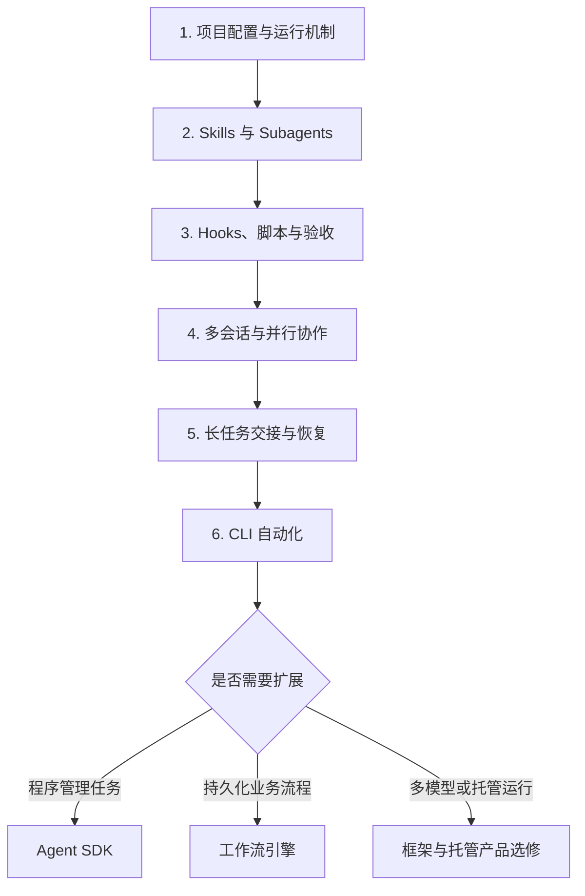

# 多 Agent 学习路线图：以本机 Claude Code 为主线

> **版本**：v2 · 2026-11-11  
> **适用场景**：通过本机 Claude Code、项目配置、Skills 和脚本完成研发任务。  
> **贯穿项目**：数据拉取 → Demo 开发 → 效果评测与 prompt 调优 → 基线压测 → 可选量化与回归 → 性能复测 → 服务部署。  
> **目标**：建立可重复运行、可验收、可交接和可恢复的协作流程，按实际需要扩展自动化。

## 0. 修订说明与总体脉络

上一版偏向“用框架开发 Agent 后端服务”，把托管产品文档列为主教材，与本机 Claude Code 的工作方式不够贴合。本版将配置与工具协作设为主线。

**本机运行主要描述 Agent 运行过程和工具执行的位置，不意味着 Claude 模型权重在本机推理。** Claude Agent SDK 可以由自己的进程运行，也不等同于 Managed Agents 托管服务。[工作原理](https://code.claude.com/docs/en/how-claude-code-works) · [产品区别](https://code.claude.com/docs/en/agent-sdk/overview)

本文的目录、练习和验收条件是建议设计；功能以安装版本对应的官方文档为准。实践前记录 `claude --version`。不将案例中的旧模型参数直接作为当前默认值。



### 0.1 新的主阅读材料

| 顺序 | 主教材 | 要解决的问题 |
|---|---|---|
| 1 | [How Claude Code works](https://code.claude.com/docs/en/how-claude-code-works)、[Memory / CLAUDE.md](https://code.claude.com/docs/en/memory)、[Settings](https://code.claude.com/docs/en/settings) | 项目约定、实际设置和执行循环各是什么？ |
| 2 | [Skills](https://code.claude.com/docs/en/skills)、[Subagents](https://code.claude.com/docs/en/sub-agents) | 如何复用工作方法、委派独立任务、交接结果？ |
| 3 | [Hooks](https://code.claude.com/docs/en/hooks)、[Permissions](https://code.claude.com/docs/en/permissions) | 如何记录事件、执行检查和控制工具权限？ |
| 4：按需 | [程序化运行](https://code.claude.com/docs/en/headless)、[Agent SDK](https://code.claude.com/docs/en/agent-sdk/overview) | 如何从交互式工作扩展到脚本和应用？ |
| 工程案例主读 | [Harness design for long-running application development](https://www.anthropic.com/engineering/harness-design-long-running-apps) | 规划、实现、验收与跨会话交接如何配合？ |

### 0.2 旧资料重新定位

| 原材料 | 新定位 |
|---|---|
| How we built our multi-agent research system | 已读背景；保留分工、证据、评估与恢复原则 |
| Multiagent Orchestration（Managed Agents） | 托管产品选修，当前无需照着其 API 构建本机流程 |
| Scaling Managed Agents | 后期架构选修，学习解耦与故障边界 |
| Harness design for long-running application development | 保留为工程案例主读 |
| ADK / LangGraph / Deep Agents 源码 | 需要自定义框架或多模型时再深入 |
| Open Deep Research | 历史实现选读，不承担本机入门主线 |

## 1. 运行机制与项目配置

### 1.1 分清配置、知识和执行

阅读：[工作原理](https://code.claude.com/docs/en/how-claude-code-works)、[Memory](https://code.claude.com/docs/en/memory)、[Settings](https://code.claude.com/docs/en/settings)。

| 载体 | 职责 | 不能代替的东西 |
|---|---|---|
| `CLAUDE.md` | 项目约定、常用命令、验收入口、资料索引 | 确定性状态机 |
| `.claude/rules/` | 按主题或范围组织项目指导 | 系统权限控制 |
| `.claude/settings.json` | 项目设置、权限和 Hooks 配置 | 临时任务日志与密钥存储 |
| `.claude/skills/` | 可复用的知识、操作流程和辅助资源 | 默认独立运行的多个 Agent |
| `.claude/agents/` | 自定义子 Agent 定义 | 完整业务流水线 |
| 项目脚本与状态存储 | 实际执行、校验、记录与恢复 | 只给模型阅读的建议 |

**练习**：整理一份简短 `CLAUDE.md`，写明开发入口、测试命令、产物位置和完成标准；长篇步骤放到对应 Skill 或文档。分别管理共享项目设置与个人设置。

**验收**：新会话能找到正确命令和资料；能够解释某项设置实际来自哪个配置文件。

### 1.2 项目指导与权限分别验证

阅读：[Permissions](https://code.claude.com/docs/en/permissions)。

练习：分别验证只读分析和代码修改需要哪些工具权限。对严格隔离需求，结合执行环境和外部授权实现，不能仅靠“禁止修改”的自然语言约定。

## 2. Skills 与 Subagents

### 2.1 Skills：复用工作方法【必做】

阅读：[Skills](https://code.claude.com/docs/en/skills)。

先把“运行评测”和“分析报告”整理成两个操作流程，明确输入、执行入口、输出位置、失败结果与完成条件。

Skill 默认不等于一个新 Agent；官方也提供 `context: fork` 等独立子 Agent 执行方式。具体触发、工具和上下文行为应按配置文档核对。

**验收**：同一个 Skill 在两个新会话中都能调用正确执行器，生成一致结构的结果。

### 2.2 Subagents：独立任务与结果交接【必做】

阅读：[Subagents](https://code.claude.com/docs/en/sub-agents)。

建议先设置两个自定义角色：

- **开发角色**：修改候选代码或 prompt，返回变更、版本和测试结果。
- **分析角色**：读取评测与压测报告，返回失败分类、证据和下一轮建议。

学习委派条件、工具范围、模型配置、上下文来源和结果返回机制。不要预设子任务自动看到主会话全部历史。

分派至少包含目标、输入版本、范围、输出位置和完成标准；返回至少包含状态、产物引用、证据和未解决事项。

**验收**：主会话依据实际产物继续工作；子任务能够明确返回失败或部分完成。

### 2.3 比较三种方式

用同一批任务比较“主会话直接执行”“主会话使用 Skill”“主会话委派子 Agent”，记录质量、耗时、费用和人工纠正。

七个业务阶段不必对应七个 Agent。只有上下文隔离、独立分工或并行带来收益时，才增加角色。

## 3. Hooks、执行脚本与验收

### 3.1 将重复操作固化为执行器

这一阶段先读自己的脚本和接口，无需先通读其他 Agent 框架源码。

建议接口示意：

```text
prepare_data(config) -> dataset_id
evaluate(candidate_id, dataset_id) -> report_id
submit_quantization(model_id, config) -> job_id
get_job_status(job_id) -> status
benchmark(candidate_id, load_profile) -> report_id
deploy(release_manifest) -> deployment_id
```

让 Agent 理解需求、选择参数和分析结果；程序完成计算、版本记录与校验。长 GPU 作业返回 `job_id`，由作业系统维护生命周期。

**验收**：每个操作都能脱离 Claude Code 单独运行和检查。

### 3.2 在明确事件上执行检查

阅读：[Hooks reference](https://code.claude.com/docs/en/hooks)。

学习工具调用前后、子任务结束和会话停止等事件，以及输入、退出码、阻断能力和超时行为。不同事件的返回语义不能混用。

练习：执行器完成后记录结果引用；结束前检查必要报告是否存在、版本是否匹配。测试检查脚本自身失败时的处理，并避免停止事件无上限触发继续执行。

**验收**：缺少报告或版本不匹配能被检测；检查异常不会被当成通过。Hooks 不自动提供完整调度、事务或安全边界。

### 3.3 用实际结果评估协作

阅读：[Demystifying evals for AI agents](https://www.anthropic.com/engineering/demystifying-evals-for-ai-agents)。

保留固定案例、独立验收集和版本化评测器。开发角色可以改实现，不应未经评审同时降低验收标准。

除业务效果外，还记录人工修正、总耗时、费用和恢复结果。GPU 压测、量化与其他推理任务按明确资源策略运行，保持比较条件可解释。

## 4. 多会话与并行协作

### 4.1 先掌握 Subagents 与文件隔离

阅读：[Subagents](https://code.claude.com/docs/en/sub-agents)、[Common workflows](https://code.claude.com/docs/en/common-workflows)。

独立上下文不自动等于独立文件环境。并行改代码时分配文件所有权，或使用支持的 worktree 隔离；确认实际基线 commit、工作目录和合并结果。

**练习**：先并行分析代码与评测报告，再尝试互不重叠的修改任务。

**验收**：结果可汇总，文件没有被互相覆盖，合并后测试通过。

### 4.2 Agent Teams【进阶实验】

阅读：[Orchestrate teams of Claude Code sessions](https://code.claude.com/docs/en/agent-teams)。

这份文档更贴近多个 Claude Code 会话协作，涵盖任务协调和成员通信。核查时仍标为 experimental，默认关闭，并提示恢复、任务协调和退出方面的限制；进程内成员不会随 `/resume` 自动恢复。

**练习**：先用团队做并行研究或审查，再尝试职责清晰的模块开发。测试任务认领、消息、退出、恢复和文件冲突。

**验收**：说明相比 Subagents 多获得的能力，以及实验性限制如何处理。演示成功不等于无人值守可靠性已经成立。

## 5. 长任务、产物交接与恢复

### 5.1 区分三种状态

阅读：[Checkpointing](https://code.claude.com/docs/en/checkpointing)、[Common workflows](https://code.claude.com/docs/en/common-workflows)。

| 状态 | 恢复对象 | 建议手段 |
|---|---|---|
| 会话上下文 | 讨论、背景与任务方向 | 会话恢复或明确交接记录 |
| 代码状态 | 文件内容和版本 | Git 与工具支持的文件回退 |
| 业务作业状态 | 量化进度、评测结果、外部部署 | 作业 ID、持久化记录、幂等接口和状态查询 |

文件 checkpoint 不会撤销所有命令带来的外部变化；恢复对话不等于恢复 GPU 进程或回滚部署。

### 5.2 独立记录任务状态与产物

建议保存 `run_id`、阶段、输入版本、输出引用、外部 `job_id`、已验证检查、错误与下一步。执行脚本负责核验和更新状态，模型总结辅助理解。

**验收实验**：评测完成后关闭会话，在新会话中根据记录继续，避免重复已完成工作；再测试外部作业仍运行和已经失败两种情况。

### 5.3 工程案例阅读

- **主读**：[Harness design for long-running application development](https://www.anthropic.com/engineering/harness-design-long-running-apps)：规划、实现、验收和交接。
- **选读**：[Effective harnesses for long-running agents](https://www.anthropic.com/engineering/effective-harnesses-for-long-running-agents)：阶段进展、环境准备和持续工作。
- **选读**：[Building a C compiler with a team of parallel Claudes](https://www.anthropic.com/engineering/building-c-compiler)：代码同步、任务分工与测试反馈；属于研究原型。
- **已读回顾**：[How we built our multi-agent research system](https://www.anthropic.com/research/multi-agent-research-system)：将已整理的原则映射到本机项目。

## 6. 从交互式工作到自动运行

### 6.1 先用 CLI【按需】

阅读：[Run Claude Code programmatically](https://code.claude.com/docs/en/headless)。

学习 `claude -p`、结构化输出、结果检查和配置加载。先接入一个稳定的分析任务，再串联阶段。

在相同工作目录和版本配置下验证行为。退出码或模型声称成功不替代产物验收；外层程序负责处理权限等待、超时与无效结果。

**验收**：无需手动复制粘贴即可运行一个阶段，并区分成功、失败和需要人工输入。

### 6.2 再用 Agent SDK【按需】

阅读：[Agent SDK](https://code.claude.com/docs/en/agent-sdk/overview)。

需要 Python/TypeScript 程序管理任务、消息、会话和权限回调时再学。它是本机方案可选的程序化延伸；迁移时核对项目设置和 Skills 的加载方式，不假设全部无条件继承。

### 6.3 何时需要外层工作流

需要多个研发任务并发、跨进程恢复、持久化审批或长 GPU 作业协调时，评估 [Prefect](https://www.prefect.io/docs/v3/get-started) 或 [Temporal](https://docs.temporal.io/develop/python)。

外层保存阶段与作业状态，Agent 完成阶段内智能任务，避免两层同时自由规划全流程。

## 7. 贯穿项目与建议目录

### 7.1 用自己的研发交付流程练习

| 阶段 | Agent 的职责 | 程序需要提供的产物 |
|---|---|---|
| 数据拉取 | 理解需求、分析异常 | 数据快照、校验与版本 |
| Demo 开发 | 改代码、定位问题 | commit、构建与测试报告 |
| 效果评测与调优 | 分析失败、提出候选修改 | 固定评测结果与候选版本 |
| 基线压测 | 分析性能瓶颈 | 负载配置、硬件信息与指标 |
| 可选量化与回归 | 提议配置、解释质量变化 | 模型引用与回归报告 |
| 性能复测 | 比较基线、提出取舍 | 同条件性能对比 |
| 部署 | 整理发布材料、分析异常 | 发布条件检查、部署与回滚记录 |

目标模型可在 A100 上运行，Claude Code 通过命令或 [MCP](https://code.claude.com/docs/en/mcp) 提交、查询作业；这与 Claude 模型本身的推理位置是两个问题。

### 7.2 建议目录

以下仅为项目结构建议，没有自动安装或修改本机配置。Claude 原生目录之外的文件与协议由项目自行实现。

```text
project/
├── CLAUDE.md
├── .claude/
│   ├── settings.json
│   ├── rules/
│   ├── agents/
│   │   ├── developer.md
│   │   └── analyst.md
│   └── skills/
│       ├── run-evaluation/SKILL.md
│       ├── analyze-results/SKILL.md
│       └── prepare-release/SKILL.md
├── scripts/
│   ├── prepare_data.py
│   ├── evaluate.py
│   ├── submit_quantization.py
│   ├── benchmark.py
│   └── check_release.py
├── evals/
│   ├── cases/
│   └── acceptance.yaml
├── docs/
│   └── workflow.md
└── runs/
    └── <run_id>/
        ├── manifest.json
        ├── status.json
        ├── handoff.md
        └── reports/
```

`acceptance.yaml` 等不是原生 Claude Code 协议，需要脚本读取。并发状态更新使用单写入者、锁或数据库事务；共享 JSON 文件本身不提供可靠调度。

### 7.3 递进验收

1. 一个会话配合 Skills 跑通开发与评测，产物可独立检查。
2. 拆出分析子 Agent，确认分工产生可测收益。
3. 模拟工具失败、会话退出和作业超时，能够识别状态并继续。
4. 需要直接通信或独立模块开发时，再实验团队与多会话。
5. 用 CLI / SDK 自动执行稳定阶段，外层检查产物。
6. 有限试运行，记录成功率、费用、耗时和人工介入，变更后回归。

## 8. 学习节奏与源码学习

| 周次 | 重点 | 可检查的产出 |
|---|---|---|
| 第 1 周 | 配置、Skills | 项目约定、两个可重复执行流程 |
| 第 2 周 | Subagents、交接 | 开发与分析分工、结果协议 |
| 第 3 周 | Hooks、脚本、评估 | 产物检查、固定案例与报告 |
| 第 4 周 | 并行、恢复 | 冲突处理记录、会话中断实验 |
| 第 5 周：按需 | CLI / SDK | 自动执行一个阶段 |
| 第 6 周：按需 | 多任务或托管选型 | 是否扩展的实测依据 |

这是可调整的学习安排，不是上线承诺。

### 8.1 源码学习改为先读实际使用的实现

先读自己的 Skill、Agent 定义、Hook 与执行脚本，追踪一次任务的调用和产物；随后看 [Claude Cookbooks](https://github.com/anthropics/claude-cookbooks) 与 SDK 示例。示例或客户端 SDK 不等于 Claude Code 完整运行时实现。

研究框架内部机制时，再读 [ADK Python](https://github.com/google/adk-python) 或 [Deep Agents](https://github.com/langchain-ai/deepagents)。它们不是完成本机协作的前置条件。

### 8.2 原托管主教材延后学习

- 想让供应商托管运行过程，再读 [Managed Agents Multiagent Orchestration](https://platform.claude.com/docs/en/managed-agents/multiagent-orchestration)。
- 需要服务级会话、执行环境和故障边界知识，再读 [Scaling Managed Agents](https://www.anthropic.com/engineering/managed-agents)。
- 需要自定义多模型架构，再深入 ADK / LangGraph 等框架。

**当前最短路径：CLAUDE.md / Settings → 两个 Skills → 两个 Subagents → 执行脚本与 Hooks → 固定评估 → 会话交接与恢复 → 按需 CLI / SDK。**
