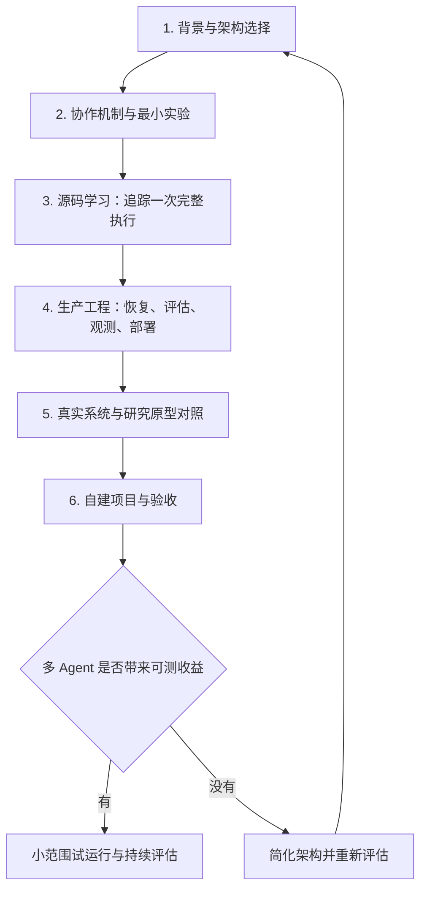

# 多 Agent 生产系统学习路线图

适用基础：已了解 Agent、ReAct、Reflection、Tool、Skill，并接触过 Google ADK。

资料核查日期：2026-11-04。本文的顺序、练习、时间安排和验收条件是学习建议；对资料类型与日期的说明来自对应链接。

目标：能够实现一个可评估、可恢复、可观测的多 Agent 服务，并用数据判断它是否比单 Agent 更值得使用。

## 0. 总体脉络与学习方法

推荐主线：用 ADK 做自己的项目，用 Deep Agents 的实现作对照。无需同时掌握两个框架的全部功能。

每阶段都保留一个可检查的产出。第 6 阶段的项目从第 2 阶段开始建立，边学边补，不等所有资料看完才动手。第 5 阶段的案例可先浏览，完成生产工程学习后再精读。

时效性处理：

- 旧文章用于理解设计动机；模型能力、性能数字和特殊补救策略需要重新验证。
- 实现时记录框架版本、模型标识、提示词版本和源码 commit，保证代码与文档版本对应。
- [Open Deep Research](https://github.com/langchain-ai/open_deep_research) 已于 2026-08-21 归档，放在历史源码选读，不作为新项目默认底座。
- [Agent Starter Pack](https://github.com/GoogleCloudPlatform/agent-starter-pack) 页面显示已归档，README 指向 [Agents CLI](https://google.github.io/agents-cli/)。部署学习采用后者入口。
- 教学示例、开源框架、研究原型、已上线产品的复盘分别标注；“能运行”与“满足业务上线要求”是两件需要分别验证的事。

## 1. 背景了解：为什么需要多个 Agent

### 1.1 架构选择：单 Agent、固定工作流、动态协作【必读】

资料：[ADK Workflows](https://adk.dev/workflows/)。

阅读重点：固定顺序、并行分支、图工作流、动态工作流与协调者委派，分别把哪些决定交给程序、哪些交给模型。

练习：对自己的业务分别画出单 Agent、固定工作流、多 Agent 三种方案。写出拆分的理由，例如独立上下文、工具权限差异、可并行任务，而不只是不同角色名称。

验收产出：一页架构选择说明，包含收益假设、额外成本和无需使用多 Agent 的情况。

### 1.2 了解失败模式【必读】

资料：[Why Do Multi-Agent LLM Systems Fail?](https://arxiv.org/abs/2503.13657)（论文页面可进入 PDF）。

阅读重点：任务规定与系统设计、Agent 间协调偏差、验证和终止这三类问题。把它作为诊断参考，论文样本中的结果不直接代表所有生产系统。

验收产出：为自己的场景列出五种失败，例如重复调查、遗漏证据、传递错误结论、反复转交、提前结束；为每种失败指定检测信号。

### 1.3 书籍与 PDF：按需查阅【选读】

- [Agentic Design Patterns — Antonio Gullí](https://link.springer.com/book/10.1007/978-3-032-01402-3)：优先查 Multi-Agent Collaboration、Memory Management、Goal Setting and Monitoring。出版社提供 PDF/EPUB，可能需要购买或机构访问。
- [Building Effective AI Agents — Anthropic 官方 PDF](https://resources.anthropic.com/hubfs/Building%20Effective%20AI%20Agents-%20Architecture%20Patterns%20and%20Implementation%20Frameworks.pdf)：用于概览架构与选型，代码学习仍以当前文档和源码为主。

## 2. 协作机制：任务、上下文与控制权怎么流动

### 2.1 先跑通固定流程【必做】

资料：[Google ADK 协作 Codelab](https://codelabs.developers.google.com/devsite/codelabs/build-agents-with-adk-orchestrating-agent-workflows?hl=en)【教学示例】；[当前 Graph Workflows 文档](https://adk.dev/graphs/)【实现文档】。

阅读重点：Codelab 中的顺序、并行、循环，以及通过 `output_key` 和 session state 传递结果；然后对照当前图工作流中的节点、路由和数据流。不同版本示例不要直接混用。

练习：实现“输入解析 → 两个独立分析任务 → 汇总”。并行任务各自写入独立结果字段，由汇总步骤合并。将确定性的字段校验留给代码。

验收产出：一次完整执行记录，能看到每个节点的输入、输出、耗时和状态变化。

### 2.2 再做动态委派与上下文隔离【必读、必做】

资料：[ADK Collaborative Workflows](https://adk.dev/workflows/collaboration/)；[Deep Agents Subagents](https://docs.langchain.com/oss/python/deepagents/subagents)。

阅读重点：协调者如何选择子任务；子 Agent 接收哪些上下文、拥有哪些工具、返回哪些结果；同步等待与上下文隔离的关系。

练习：设计明确的任务与结果结构。建议任务包含 `task_id`、目标、输入引用、允许工具和预算；结果包含状态、结论、证据引用、未确认事项和错误信息。字段结构由程序校验，事实正确性另行验证。

验收产出：任务协议与结果协议，以及一例“任务无法完成”的返回示例。

### 2.3 长任务、后台执行与取消【进阶】

资料：[Deep Agents Async Subagents](https://docs.langchain.com/oss/python/deepagents/async-subagents)；[Claude Multiagent Orchestration](https://platform.claude.com/docs/en/managed-agents/multiagent-orchestration)【托管产品文档，核查时为 Beta】。

阅读重点：同步调用与后台任务的生命周期差异；任务标识、进度查询、结果交付、跟进、取消和预算如何表达。各产品支持的操作与限制以其文档为准。

验收产出：画出自己的任务状态机，例如 pending → running → succeeded / failed / cancelled，并明确取消后仍可能发生的在途工具调用如何处理。

## 3. 源码学习：沿一次任务追踪执行过程

### 3.1 主线：Google ADK 的运行与状态机制【必读】

资料：[ADK Python 仓库](https://github.com/google/adk-python)；[核心源码目录](https://github.com/google/adk-python/tree/main/src/google/adk)；[Agents 目录](https://github.com/google/adk-python/tree/main/src/google/adk/agents)。

阅读顺序：从自己已跑通的示例进入运行入口，追踪 Agent/工作流执行、模型调用、工具分派、事件生成、session 更新和结果返回。围绕一次具体调用阅读，避免从仓库第一行通读。

需要回答：

- 模型返回一个委派意图后，哪段代码真正启动子任务？
- 下一步由模型选择，还是由工作流路由决定？
- 父子 Agent 的消息与共享状态边界在哪里？
- 并行分支产生事件后，怎样合并和保存？
- 子任务报错如何传回调用方？

验收产出：一张调用时序图，附关键函数位置和所读 commit。

### 3.2 对照：Deep Agents 的子任务封装【进阶】

资料：[Deep Agents 仓库](https://github.com/langchain-ai/deepagents)；[核心源码目录](https://github.com/langchain-ai/deepagents/tree/main/libs/deepagents/deepagents)。

阅读顺序：从 `graph.py` 了解装配方式，再到 `middleware/` 中查找子 Agent 委派实现，结合 `backends/` 理解文件和执行环境的抽象。用第 2.2、2.3 节文档查到的接口反向定位源码。

重点检查：委派怎样暴露为工具；传给子 Agent 的状态怎样构建；哪些结果进入主上下文；异常、取消与上下文压缩分别由哪层处理。

验收产出：一张 ADK 与 Deep Agents 对照表，只比较状态、委派、恢复、工具权限四项，不以 API 数量判断优劣。

### 3.3 历史应用案例：Open Deep Research【选读】

资料：[仓库及归档状态](https://github.com/langchain-ai/open_deep_research)。

建议阅读顺序：

1. [`state.py`](https://github.com/langchain-ai/open_deep_research/blob/main/src/open_deep_research/state.py)：任务与各角色状态。
2. [`deep_researcher.py`](https://github.com/langchain-ai/open_deep_research/blob/main/src/open_deep_research/deep_researcher.py)：分派、研究循环、压缩、汇总。
3. [`prompts.py`](https://github.com/langchain-ai/open_deep_research/blob/main/src/open_deep_research/prompts.py)：哪些行为依赖提示词。
4. [`configuration.py`](https://github.com/langchain-ai/open_deep_research/blob/main/src/open_deep_research/configuration.py)：并发、迭代与模型设置。

验收产出：解释“用户需求 → supervisor → researcher → 结果压缩 → 报告”的完整路径，并指出程序强制限制与模型自行判断的边界。

## 4. 生产工程：把可运行流程变成可靠服务

### 4.1 状态持久化、故障恢复与幂等【必做】

资料：[ADK Resume Agents](https://adk.dev/runtime/resume/)；[LangGraph Persistence](https://docs.langchain.com/oss/python/langgraph/persistence)；[Fault Tolerance](https://docs.langchain.com/oss/python/langgraph/fault-tolerance)。

学习重点：区分模型上下文、运行状态、持久化业务数据；明确检查点边界、失败重试范围、超时与部分成功的处理。

验收实验：执行中途终止进程并恢复；重复提交同一任务；让一个分支超时。证明已完成结果能够复用，外部写入不会因为重试被重复执行。检查点本身不等于外部副作用的“恰好一次”。

### 4.2 评估与可观测性【必做】

资料：[Demystifying Evals for AI Agents，2026-01-09](https://www.anthropic.com/engineering/demystifying-evals-for-ai-agents)；[ADK Observability](https://adk.dev/observability/)。

学习重点：检查真实任务结果，而非只检查回答是否像成功；区分模型评审、确定性校验与人工复核。记录父子任务关系、工具调用、耗时、费用和最终状态。

验收产出：一组固定案例和一份对比报告，包含成功率、人工修正量、费用、延迟、失败原因。随机性明显的任务重复运行。涉及工具返回内容时，为日志设置脱敏与保留规则。

### 4.3 人工介入与工具权限【必做】

资料：[LangGraph Interrupts](https://docs.langchain.com/oss/python/langgraph/interrupts)；[ADK Safety and Security](https://adk.dev/safety/)。

学习重点：审批等待如何持久化；审批应绑定具体动作与参数；恢复时是否需要重新检查外部状态；每个 Agent 的工具授权应在执行层落实。

验收实验：暂停等待审批后重启服务，再继续任务；模拟工具越权调用，确认执行层拒绝；让审批后的参数发生变化，确认旧审批不能授权新的动作。

### 4.4 部署、预算与版本迭代【必做】

资料：[Google Agents CLI](https://google.github.io/agents-cli/)；[Claude Multiagent Orchestration](https://platform.claude.com/docs/en/managed-agents/multiagent-orchestration) 中的预算及会话管理相关入口。

学习重点：开发、测试和运行环境如何分离；提示词、模型、工具和代码如何一起版本化；并发、运行时长、循环次数、费用如何限额。

验收产出：部署说明、回滚步骤、版本清单，以及一次超预算/超时终止的验证记录。托管运行与自行部署选一种先完成，不要求同时落地所有平台。

## 5. 真实系统与研究原型：对照架构取舍

### 5.1 Claude Research【已上线产品的工程复盘】

资料：[How We Built Our Multi-Agent Research System，2025-06-13](https://www.anthropic.com/research/multi-agent-research-system)。

阅读重点：主 Agent 分派、并行研究、任务边界、结果汇总与评估。把成本和能力数字作为当时系统的观测值；公开文章没有披露完整服务端源码。

验收产出：用自己第 3 阶段读到的代码，解释文中哪些机制可以实现；对未披露的重试、存储、调度细节标记“未知”，不要自行补成产品事实。

### 5.2 Claude Managed Agents【托管服务的工程复盘】

资料：[Scaling Managed Agents: Decoupling the Brain from the Hands，2026-04-08](https://www.anthropic.com/engineering/managed-agents)。

阅读重点：模型执行循环、沙箱与持久化会话记录分离；组件失败后的恢复；模型升级后重新审视原来的补救措施。这篇更偏运行基础设施，和第 5.1 节的任务协作层互补。

验收产出：画出自己的服务故障边界，说明执行循环、数据库、工具或沙箱分别失败时会丢失什么、如何恢复。

### 5.3 长时间应用开发【工程实验，选读】

资料：[Harness Design for Long-Running Application Development，2026-03-24](https://www.anthropic.com/engineering/harness-design-long-running-apps)。

阅读重点：planner、generator、evaluator 的交接，跨会话结构化产物，验收标准与反馈循环。

验收产出：为自己的任务写一个可执行的验收标准，并说明哪些检查由程序完成、哪些需要模型或人工判断。独立 evaluator 的存在不自动保证正确性。

### 5.4 多 Agent 编译器项目【早期研究原型，选读】

资料：[Building a C Compiler with a Team of Parallel Claudes，2026-02-05](https://www.anthropic.com/engineering/building-c-compiler)。

阅读重点：独立容器、共享代码仓库、任务认领、变更合并、测试反馈。作者明确称其为早期原型。

验收产出：对比集中协调与自主认领任务两种方式，列出自己的业务需要哪种；识别从该原型走向业务生产仍要补的部分。

## 6. 贯穿项目：故障排查报告助手

以下是建议练习，不是上述公司的已部署案例。可先使用本地、脱敏或合成数据。

### 6.1 建立单 Agent 基线

输入告警、时间范围、日志、指标与变更记录。输出证据、候选原因、未知事项和下一步建议。先整理约 20–30 个有参考结论的案例，作为初始学习集；业务上线所需覆盖范围要另行确定。

### 6.2 建立固定并行版本

实现“输入解析 → 日志/指标/变更三个独立分析分支 → 汇总”。记录完整过程。时间范围与数据版本保持一致，结果附证据引用；汇总时保留矛盾和不确定性。

### 6.3 根据不足引入动态委派

只有在固定流程无法合理覆盖任务时，才允许协调者追加子任务。设置最大并发、调用次数、时间与费用预算，并定义证据不足时的退出结果。

### 6.4 注入故障并验证恢复

至少覆盖：工具超时、返回格式错误、一个分支失败、重复提交、服务重启、用户取消、预算耗尽，以及需审批动作的暂停和恢复。

### 6.5 用同一组案例比较三个版本

| 维度 | 单 Agent | 固定并行工作流 | 动态多 Agent |
|---|---|---|---|
| 任务成功率 | 实测 | 实测 | 实测 |
| 证据准确性与遗漏 | 实测 | 实测 | 实测 |
| 人工修正量 | 实测 | 实测 | 实测 |
| 单任务费用 | 实测 | 实测 | 实测 |
| 中位数与 P95 耗时 | 实测 | 实测 | 实测 |
| 故障恢复结果 | 实测 | 实测 | 实测 |

为比较记录相同的数据集、模型版本和预算规则；报告质量与成本的关系。小样本的 P95 只能用作初步观察。不要预设多 Agent 一定胜出。

### 6.6 小范围试运行

选择有限场景与使用者，保留人工处理入口，持续收集失败案例并加入回归集。变更提示词、模型、工具或框架后重新评估。把允许上线的阈值绑定业务要求，不采用一个通用成功率数字。

验收产出：可运行服务、调用时序图、任务/结果协议、评估报告、故障恢复记录、部署与回滚说明。完成这些产出可作为进入有限试运行的准备；是否扩大使用范围取决于实测结果。

## 7. 建议节奏与最短路径

按每周约 5–8 小时估算，下面是可调整的六周节奏，不代表业务上线承诺。

| 周次 | 重点 | 本周产出 |
|---|---|---|
| 第 1 周 | 1、2.1；建立案例集与单 Agent 基线 | 架构选择说明、首个运行记录 |
| 第 2 周 | 2.2、3.1；固定并行版本 | 任务协议、调用时序图 |
| 第 3 周 | 2.3、4.1；必要时加入动态委派 | 状态机、恢复实验 |
| 第 4 周 | 4.2、4.3 | 评估报告、追踪与审批实验 |
| 第 5 周 | 4.4、5.1、5.2 | 部署说明、故障边界图 |
| 第 6 周 | 6.4–6.6；按需选读其他资料 | 三方案比较、试运行建议 |

时间有限时，按以下最短路径推进：

**ADK Workflows → 跑通一个流程 → ADK 源码追踪 → 持久化与恢复 → 评估与观测 → Managed Agents 工程复盘 → 自己的三方案对比报告。**

核心自测：我能否解释一次任务从输入到结束的每一步；中途失败能否恢复；是否知道在哪一步、因为什么失败；是否有证据说明多 Agent 比更简单的方案更值得使用。
