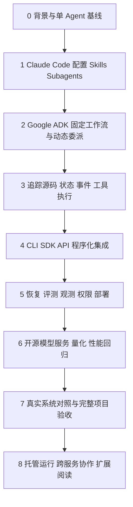

# 多 Agent 生产系统完整学习路线图

> v3 · 2026-11-11  
> 主线：Claude Code 实践 → Google ADK 编排与源码 → CLI / SDK / API 集成 → 生产工程 → 模型部署与优化 → 真实系统对照。  
> 适用基础：已理解 Agent、ReAct、Reflection、Tool、Skill，正在使用本机 Claude Code。  
> 目标：既能使用现成工具完成工作，也能解释、实现和维护一个可评测、可恢复、可观测的多 Agent 系统。

## 0. 如何使用这份路线图

### 0.1 学习顺序不等于产品的技术高低

Claude Code 是现成的 Agent 产品和运行环境；ADK 是构建 Agent 的框架；CLI、SDK、API 是调用和集成方式。三者不是互相替代的等级关系。这里按“先实践 → 再掌握内部控制 → 再对外集成”的学习顺序安排。

ADK 入门就会涉及模型 API，Claude Code 本身就有 CLI；后面的 API/CLI 阶段专门研究无人值守调用、任务协议和服务化。本文的 ADK 指 **Google ADK**；Anthropic 的程序化开发工具按 **Claude Agent SDK** 学习，避免把两者混称。

本机运行 Agent 与本机运行模型是两个维度。自己的电脑可以运行编排程序，同时调用闭源模型 API，并把量化、压测任务提交给远端 GPU 机器。



所有阶段使用同一个项目：**数据拉取 → Demo 开发 → 效果评测与 Prompt 调优 → 基线压测 → 量化与效果回归 → 再压测 → 服务部署**。先完成小规模闭环，再逐步提高可靠性，不要每学一个框架就另起一个无关 Demo。

### 0.2 主阅读材料：保留，并放到合适阶段

| 材料 | 定位 | 阅读时机与问题 |
|---|---|---|
| [How We Built Our Multi-Agent Research System](https://www.anthropic.com/research/multi-agent-research-system) | 已上线产品的公开工程复盘，你已读过 | 入门回顾；完成项目后重读任务边界、并行收益和协调成本 |
| [Harness Design for Long-Running Application Development](https://www.anthropic.com/engineering/harness-design-long-running-apps) | 长任务工程实验，核心主教材 | 阶段 1 与 5；研究跨会话交接、验收和反馈循环 |
| [Scaling Managed Agents](https://www.anthropic.com/engineering/managed-agents) | 托管服务架构复盘，核心主教材 | 阶段 5；研究执行循环、沙箱和持久状态的故障边界 |
| [Multiagent Orchestration](https://platform.claude.com/docs/en/managed-agents/multiagent-orchestration) | 特定托管产品的接口文档，核心对照材料 | 阶段 4 初读、阶段 8 深读；与自己的任务协议和运行系统对照 |
| [Google ADK 文档](https://adk.dev/)与[源码](https://github.com/google/adk-python) | 自建系统的实现主线 | 阶段 2–5；将文章中的设计原则落实为可执行代码 |

书籍与 PDF 用作概念索引，不代替实现文档：

- [Agentic Design Patterns](https://link.springer.com/book/10.1007/978-3-032-01402-3)：按需查阅协作、记忆、监控等章节；出版社访问可能需要购买或机构权限。
- [Building Effective AI Agents 官方 PDF](https://resources.anthropic.com/hubfs/Building%20Effective%20AI%20Agents-%20Architecture%20Patterns%20and%20Implementation%20Frameworks.pdf)：架构模式概览。
- [Why Do Multi-Agent LLM Systems Fail?](https://arxiv.org/abs/2503.13657)：失败模式论文，可从页面下载 PDF；将结论作为诊断参考，不能直接泛化为所有系统的失败率。

### 0.3 版本与证据规则

记录 Claude Code 版本、ADK 版本、源码 commit、模型标识、数据和 Prompt 版本。ADK 当前文档包含新版图工作流，也保留模板工作流；旧教程与新 API 不直接混用，按所安装版本验证。

文章中的性能数字只代表其测试条件。公开复盘未披露的生产机制标记为“未知”；自己的扩展设计标记为“设计建议”。每阶段以产出验收，不以看完多少链接衡量进度。

## 1. Claude Code：先建立可重复的协作体验

### 1.1 配置、上下文与执行环境【必学】

阅读：[运行机制](https://code.claude.com/docs/en/how-claude-code-works)、[CLAUDE.md 与 Memory](https://code.claude.com/docs/en/memory)、[Settings](https://code.claude.com/docs/en/settings)、[Permissions](https://code.claude.com/docs/en/permissions)。

掌握项目指导、配置作用域、工具权限、工作目录与会话上下文的区别。CLAUDE.md 中的文字约束不等价于执行层权限。

练习：为贯穿项目建立简短的项目说明、可运行命令和验收要求；新开会话验证能否据此完成同一任务。

**产出：**项目说明、配置文件、单 Agent 运行记录与基线评测报告。

### 1.2 Skills 与 Subagents【必学】

阅读：[Skills](https://code.claude.com/docs/en/skills)、[Subagents](https://code.claude.com/docs/en/sub-agents)。

Skills 封装可复用工作方法；Subagents 提供独立任务上下文与工具配置。默认加载 Skill 不等于启动一个新 Agent；特定配置可让 Skill 在子 Agent 中运行。

练习：将“运行评测”“分析失败案例”整理成 Skills；建立 developer 和 analyst 两种子任务，明确输入文件、允许操作、返回格式和停止条件。

**产出：**使用同一批任务比较主会话直接执行、使用 Skill、委派 Subagent 三种方式，记录成功率、上下文开销、人工干预与耗时。

### 1.3 Hooks、脚本、并行会话【必学＋进阶】

阅读：[Hooks](https://code.claude.com/docs/en/hooks)、[Agent Teams](https://code.claude.com/docs/en/agent-teams)、[常用工作流](https://code.claude.com/docs/en/common-workflows)。

先让脚本独立完成数据准备、评测、压测和结果校验，再用 Hooks 在合适事件触发检查。不同事件的阻塞、输入输出和超时语义需要分别核对。

先学习 Subagents，再试验 Agent Teams。Teams 当前仍有实验性限制，应核查所用版本的恢复与任务管理行为。多个上下文可以共享文件系统；上下文隔离不等于工作目录隔离。并行改代码时使用 worktree，并验证基线与合并结果。

**产出：**一次并行开发与独立评审实验，以及一次新会话依据产物继续工作的实验。

详细配置学习可参考保留的 [Claude Code 专题路线](./学习笔记/多Agent学习路线图(本机ClaudeCode).md)；总体学习顺序以本文为准。

## 2. Google ADK：把协作方式写成可控制的程序

### 2.1 单 Agent、工具与运行时【必学】

阅读：[ADK 首页与入门](https://adk.dev/)、[Agent Runtime](https://adk.dev/runtime/)、[ADK 示例仓库](https://github.com/google/adk-samples)。

先实现一个带工具的 Agent。区分 Agent 定义、执行入口、模型连接、工具执行、Session、事件和持久化服务。研究一次请求结束后哪些数据仍存在。

练习：把阶段 1 的评测脚本包装成工具，让 ADK Agent 调用；返回结构化报告引用，避免把整个日志塞进上下文。

**产出：**同一任务的 Claude Code 版本与 ADK 版本，共用脚本、输入和验收标准。

### 2.2 固定流程：顺序、并行、循环与图【必学】

阅读：[Template Workflows](https://adk.dev/agents/workflow-agents/)、[Graph Workflows](https://adk.dev/graphs/)、[ADK 协作 Codelab](https://codelabs.developers.google.com/devsite/codelabs/build-agents-with-adk-orchestrating-agent-workflows?hl=en)。

先完成“准备输入 → 并行分析 → 汇总”，再增加有上限的修正循环。理解节点路由、分支结果合并、共享状态与终止条件；旧版 output_key 示例需与安装版本核对。

并行分支写入独立结果，统一汇总，避免无控制地修改同一字段。确定性校验由代码完成。

**产出：**流程图与执行记录，能解释每个节点为何启动、读取什么、写入什么、何时结束。

### 2.3 动态委派与控制权转移【必学】

阅读：[Collaborative Workflows](https://adk.dev/workflows/collaboration/)、[工作流总览](https://adk.dev/workflows/)。

比较固定路由、将 Agent 封装为可调用工具、转移处理权三种思路。重点追问：谁决定下一步？调用后是否返回原协调者？子 Agent 看见多少历史？失败由谁处理？具体接口以版本文档为准。

定义自己的任务协议：task_id、目标、输入引用、允许工具、预算、截止时间。结果至少包含状态、产物引用、证据、未确认事项和错误。程序校验结构，评测验证实际正确性。

**产出：**固定工作流与动态协作两个版本，并说明动态决策在什么场景带来实际收益。

### 2.4 状态、事件与中间产物【必学】

从 [ADK 文档](https://adk.dev/) 的状态、会话、产物和运行时章节继续阅读。

区分会话历史、工作流状态、长期记忆、文件产物与外部任务状态。大文件存放在产物存储中，状态保存版本和引用。不要把模型总结当作唯一业务记录。

**产出：**状态字段表、生命周期说明，以及独立的新会话读取上次产物的实验。

## 3. 源码学习：追踪一次执行，而不是通读框架

### 3.1 ADK 源码主线【必学】

入口：[ADK Python](https://github.com/google/adk-python)、[核心目录](https://github.com/google/adk-python/tree/main/src/google/adk)、[Agents 目录](https://github.com/google/adk-python/tree/main/src/google/adk/agents)。

固定一个 commit，用阶段 2 的程序打断点，依次追踪：

1. 运行入口如何创建上下文并找到 Session。
2. Agent 怎样组装模型输入并消费模型响应。
3. 工具调用怎样变成真实函数执行，异常怎样传回。
4. 委派由谁解析，子任务在哪里启动。
5. 并行事件怎样产生，状态在哪里写入。
6. 退出、取消、超时和恢复分别由哪一层处理。

**产出：**一张含关键函数位置的时序图、一份状态变更表、一次失败调用的堆栈分析。

### 3.2 第二框架对照【进阶】

阅读：[Deep Agents 源码](https://github.com/langchain-ai/deepagents)、[Subagents](https://docs.langchain.com/oss/python/deepagents/subagents)、[LangGraph Persistence](https://docs.langchain.com/oss/python/langgraph/persistence)。

从子任务工具入口反向定位状态构造、结果回传与后端执行。比较 ADK 与 Deep Agents 的上下文边界、路由、持久化、工具权限和失败传播。此阶段只迁移一个小流程，不必重写完整项目。

[Open Deep Research](https://github.com/langchain-ai/open_deep_research) 可作应用源码选读：按状态定义 → supervisor/researcher → 提示词 → 配置阅读；先检查仓库维护与归档状态，再判断是否适合作为项目依赖。

**产出：**机制对照表；能说明差异来自产品封装、框架机制还是自己选择的存储与执行器。

## 4. CLI、SDK、API：让系统被程序稳定调用

### 4.1 CLI 自动运行【必学】

阅读：[Claude Code 非交互模式](https://code.claude.com/docs/en/headless)、[ADK Runtime](https://adk.dev/runtime/)。

练习用非交互命令启动任务，处理结构化输出、退出码、标准错误、超时和取消；检查工作目录、配置加载和凭据来源。进程退出成功不代表业务验收通过。

**产出：**一条可重复的运行命令，由程序解析结果，无需人工复制对话。

### 4.2 Agent SDK：在自己的应用中使用运行循环【必学】

阅读：[Claude Agent SDK](https://code.claude.com/docs/en/agent-sdk/overview)。

用 SDK 复现前面的任务，研究会话、流式事件、工具授权、Hooks 和项目配置加载。SDK 可以在自己的环境中运行，不必使用托管沙箱。

比较两种路径：用 ADK 编写自己的 Agent 编排；用 Agent SDK 嵌入 Claude Code 的运行能力。只有边界明确且有收益时才嵌套两者，避免双层重试、预算和上下文管理。

**产出：**同一任务的 CLI 与 SDK 调用程序，并解释各自适用场景。

### 4.3 模型 API 与 Agent 服务 API【必学】

阅读：[ADK API Server 入口](https://adk.dev/runtime/)、[Managed Agents 编排](https://platform.claude.com/docs/en/managed-agents/multiagent-orchestration)。

模型 API 通常负责模型生成；Agent 服务 API 还要处理任务、工具、状态与运行生命周期。不能仅包装一个模型请求就视为完成 Agent 服务化。

为自己的服务设计提交、查询、事件订阅、取消和结果获取接口。以下是练习协议，不代表任何厂商现成接口：

```text
POST /runs                 → run_id
GET  /runs/{run_id}         → 状态与产物引用
GET  /runs/{run_id}/events  → 事件流
POST /runs/{run_id}/cancel  → 取消请求已接收
```

考虑幂等键、认证、输入校验、断线重连、重复提交和取消的最终结果。长 GPU 作业返回 job_id，后续查询；不要依赖一直打开的 HTTP 请求维持作业生命。

**产出：**一个能由另一进程调用的服务，以及重复提交与客户端断开实验。

### 4.4 MCP 与跨 Agent 协议【进阶】

阅读：[Claude Code MCP](https://code.claude.com/docs/en/mcp)、[MCP 官方文档](https://modelcontextprotocol.io/docs/getting-started/intro)、[A2A 官方项目](https://github.com/a2aproject/A2A)。

区分工具接入、同进程 Agent 委派、跨服务 Agent 通信。先使用函数/CLI/API 跑通边界，再判断协议是否有助于复用与互操作；不要求为了“多 Agent”而全部引入。

## 5. 生产工程：把可靠性落实到运行系统

### 5.1 持久化、恢复、重试与幂等【必学】

阅读：[ADK Resume](https://adk.dev/runtime/resume/)、[LangGraph Persistence](https://docs.langchain.com/oss/python/langgraph/persistence)、[Fault Tolerance](https://docs.langchain.com/oss/python/langgraph/fault-tolerance)、[Claude Code Checkpointing](https://code.claude.com/docs/en/checkpointing)。

分别处理对话恢复、代码状态恢复和业务作业恢复。检查点不自动回滚外部写入，也不保证恢复 GPU 任务。重试前检查已有产物和真实作业状态；发布、提交作业等副作用用幂等策略控制。

**实验：**终止编排进程、保留正在运行的 GPU 作业，重启后重新关联 job_id；证明既不漏结果也不重复启动。

### 5.2 评测与 Prompt 调优【必学】

阅读：[ADK Evaluation](https://adk.dev/evaluate/)、[Demystifying Evals for AI Agents](https://www.anthropic.com/engineering/demystifying-evals-for-ai-agents)。

区分最终结果评测、工具与轨迹评测、确定性检查和模型评审。不要强求所有正确任务走同一条轨迹。开发集用于调优，独立回归集用于比较；候选实现不能自行降低验收标准。

**产出：**固定案例集、版本化评分规则、失败分类；比较单 Agent、固定多 Agent、动态多 Agent 的成功率、成本、耗时和人工修正量。

### 5.3 观测、预算与资源调度【必学】

阅读：[ADK Observability](https://adk.dev/observability/)。

关联 run_id、task_id、parent_task_id、模型调用、工具调用和外部 job_id。记录延迟、token、费用、重试和失败阶段；日志处理敏感数据并设置保留规则。

限制并发、循环次数、单任务费用和总时长；重试也消耗预算。两张 GPU 上的多 Agent 不能各自无约束启动量化与压测，资源调度应由执行层控制。

**产出：**能从失败报告定位到具体工具和作业的追踪记录，以及预算耗尽的终止实验。

### 5.4 权限、人工介入与隔离【必学】

阅读：[ADK Safety](https://adk.dev/safety/)、[LangGraph Interrupts](https://docs.langchain.com/oss/python/langgraph/interrupts)。

在工具执行层落实授权，处理外部内容中的指令注入。审批绑定具体动作、参数与版本；等待审批的状态需要保存。并行开发隔离工作目录，部署使用经过验证的不可变产物。

**产出：**越权拒绝实验、审批后参数变化实验、暂停重启后继续执行实验。

### 5.5 部署与持续运行【必学】

阅读：[ADK Deployment](https://adk.dev/deploy/)、[Google Agents CLI](https://google.github.io/agents-cli/)、[Temporal 文档](https://docs.temporal.io/)、[Prefect 文档](https://docs.prefect.io/)。

先容器化部署一个小服务，配置健康检查、凭据、持久存储、并发和关闭流程。任务持续数小时、需要跨进程恢复与调度时，再选择外层工作流系统；ADK 管 Agent 内部行为，外层系统管理作业生命周期，避免两层都做无限重试。

**产出：**部署说明、版本清单、恢复操作手册、回滚流程和一次演练记录。

## 6. 模型服务、量化与性能：结合你的 A100 条件

### 6.1 分离两类模型【必学】

区分“驱动 Agent 的模型”和“流程中被评测、量化、部署的目标模型”。两者可以不同。例如闭源 API 驱动协调与开发，A100 运行目标模型推理和量化任务。

先用能力足够的 API 建立流程基线，再逐个替换成本敏感环节，减少模型能力不足与编排错误同时出现导致的诊断困难。

### 6.2 开源模型服务与兼容性【按目标必学】

阅读：[vLLM 文档](https://docs.vllm.ai/en/latest/)、[ADK 模型接入入口](https://adk.dev/)。

验证工具调用格式、结构化输出、流式响应、上下文长度、停止条件和并发，不把兼容某种 API 格式当成 Agent 能力等价。

1–2 张 80 GiB A100 能承载什么模型，需要结合权重精度、KV cache、上下文、并发和运行时开销实测；只计算参数字节数不足以决定部署容量。

### 6.3 量化回归与两轮压测【必学】

从 [vLLM 文档](https://docs.vllm.ai/en/latest/) 中查阅对应硬件、量化格式与性能测试支持，再选择具体量化工具链。不要预设某种低精度格式必然在 A100 上更快。

先保存未量化质量与性能基线；量化后在同一回归集上比较质量，再在相同负载条件下比较吞吐与延迟。校准数据与独立测试数据分开。记录首 token 延迟、生成速度、总请求耗时、吞吐、错误率与显存。

同时测试模型服务与整个 Agent 任务：单次生成更快，不一定使多轮工具调用的端到端任务更快。压测期间隔离其他占 GPU 的作业。

**产出：**模型版本 × 精度 × 上下文 × 并发的结果表，以及基于实测质量和性能的发布选择。

## 7. 真实系统阅读与贯穿项目验收

### 7.1 带着实现重读案例

| 材料 | 性质 | 对照自己系统的问题 |
|---|---|---|
| [Claude Research](https://www.anthropic.com/research/multi-agent-research-system) | 已上线系统复盘 | 独立上下文与并行研究的收益是否适用于我的任务？ |
| [Harness Design](https://www.anthropic.com/engineering/harness-design-long-running-apps) | 长任务工程实验 | 交接产物是否足够让新会话继续？验收是否真实可执行？ |
| [Effective Harnesses](https://www.anthropic.com/engineering/effective-harnesses-for-long-running-agents) | 工程经验 | 初始化、增量推进和跨会话状态如何组织？ |
| [Scaling Managed Agents](https://www.anthropic.com/engineering/managed-agents) | 服务基础设施复盘 | 执行循环、沙箱和数据库分别失败时怎样恢复？ |
| [Building a C Compiler](https://www.anthropic.com/engineering/building-c-compiler) | 多 Agent 原型实验 | 任务认领、共享代码与测试反馈如何配合？还缺什么生产机制？ |

公开复盘不是完整源代码，也不是上线标准。将可验证的机制迁移到项目，用自己的结果判断适用性。

### 7.2 一个项目逐步演进

| 版本 | 实现方式 | 新增能力与验收 |
|---|---|---|
| V0 | 脚本＋人工执行 | 数据、评测、压测命令独立可运行，建立质量基线 |
| V1 | Claude Code＋Skills | 同一流程可重复执行，产物和版本完整 |
| V2 | Claude Code＋Subagents | 开发与分析有明确交接，实测分工收益 |
| V3 | ADK 固定工作流 | 路由、状态、循环与错误由程序明确控制 |
| V4 | ADK 动态委派 | 复杂任务按需拆分，有限预算内结束 |
| V5 | CLI / SDK / API 集成 | 外部程序提交和查询任务，可处理断开与取消 |
| V6 | 持久化运行与模型服务 | 进程恢复、外部作业追踪、量化回归与部署 |
| V7 | 有限场景试运行 | 真实失败进入回归集，有监控、回滚和人工接管 |

V3 与 V4 应保留作对照；如果固定工作流效果更好，就让它成为最终方案，无需为了学过动态协作而强制上线。

### 7.3 七个业务环节的责任边界

| 环节 | Agent 的工作 | 执行程序的责任 | 必须保存的产物 |
|---|---|---|---|
| 数据拉取 | 理解需求、分析数据问题 | 拉取、校验、版本化 | dataset_id、数据说明 |
| Demo 开发 | 设计与修改代码 | 构建、测试 | commit、测试报告 |
| 评测与调优 | 分析失败、提出候选 Prompt | 固定规则运行评测 | Prompt 版本、评测报告 |
| 基线压测 | 分析瓶颈 | 隔离资源、执行负载 | 负载配置、性能报告 |
| 量化与回归 | 建议候选配置、分析退化 | 提交量化作业、回归 | job_id、模型版本、报告 |
| 再压测 | 对照质量与性能 | 同条件压测 | 前后对比报告 |
| 服务部署 | 准备发布说明、分析异常 | 发布校验、执行部署与回滚 | 产物摘要、部署版本 |

不是每个环节都需要一个 Agent。Agent 擅长开发、分析与有限决策；确定性执行和业务验收交给可独立测试的程序。

### 7.4 最终交付清单

- 可运行代码、依赖锁定、模型与数据版本、Prompt 与配置版本。
- 架构图、一次完整调用时序图、任务/结果协议与状态机。
- 单 Agent、固定工作流、动态协作的质量/费用/延迟对比。
- 工具超时、格式错误、分支失败、重复提交、进程重启、取消与预算耗尽实验。
- 外部 GPU 作业仍在运行时的恢复记录，证明不会重复提交。
- 部署与回滚手册、人工介入入口、小范围试运行结果。

## 8. 托管运行与扩展：理解完整系统的可替换边界

完整阅读 [Multiagent Orchestration](https://platform.claude.com/docs/en/managed-agents/multiagent-orchestration)，将托管平台的会话、子任务、执行环境和生命周期与阶段 4–5 自建方案逐项对照。

画两套架构：自建运行系统与托管运行系统。标注每层由谁维护、状态在哪里、如何退出平台、哪些工具仍要自行托管。无需同时购买或部署全部平台，也不假定托管平台消除了业务评测和幂等需求。

进阶选题：跨服务 Agent 通信、多租户隔离、任务队列公平性、模型路由、缓存与成本优化。完成前面的闭环后，按真实瓶颈选学。

## 9. 建议节奏与融会贯通检查

以下按每周约 5–8 小时规划，可按验收结果调整；不是上线时间承诺。

| 周次 | 主线 | 阶段成果 |
|---|---|---|
| 1–2 | 背景＋Claude Code | 脚本基线、Skills、Subagents、交接实验 |
| 3–4 | ADK 单 Agent 与固定编排 | 工具、状态、并行、循环与完整执行记录 |
| 5–6 | 动态委派＋源码 | 任务协议、断点追踪、时序图、框架对照 |
| 7–8 | CLI / SDK / API | 非交互调用、服务接口、任务生命周期 |
| 9–10 | 生产工程 | 持久化、恢复、观测、评测、权限与部署 |
| 11–12 | 模型服务与端到端验收 | 量化回归、压测、案例对照、有限试运行 |

最终应能回答：

1. Claude Code 的配置、Skill 和 Subagent，在 ADK 中分别需要哪些机制来表达？哪些没有一一对应关系？
2. 一次模型委派怎样变成真实执行？状态和结果经过哪些边界？
3. CLI、SDK 与 API 换了以后，哪些业务逻辑可以保持不变？
4. 模型超时、编排重启、GPU 作业失败分别由谁恢复？
5. 什么证据证明多 Agent 比单 Agent 或固定脚本更适合这项任务？

**学习闭环：先用 Claude Code 做出来 → 用 ADK 明确机制 → 用源码验证理解 → 用接口实现集成 → 用故障和评测证明可靠性 → 用真实案例反思架构。**
